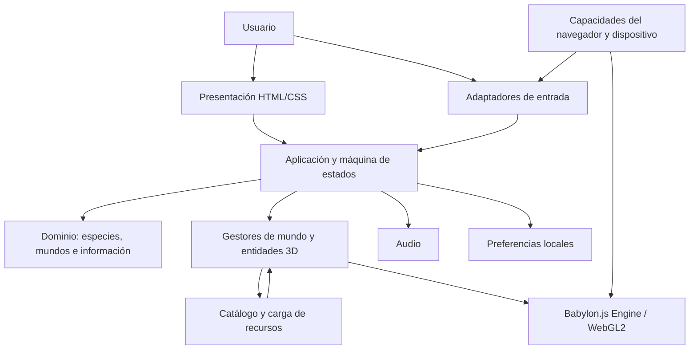
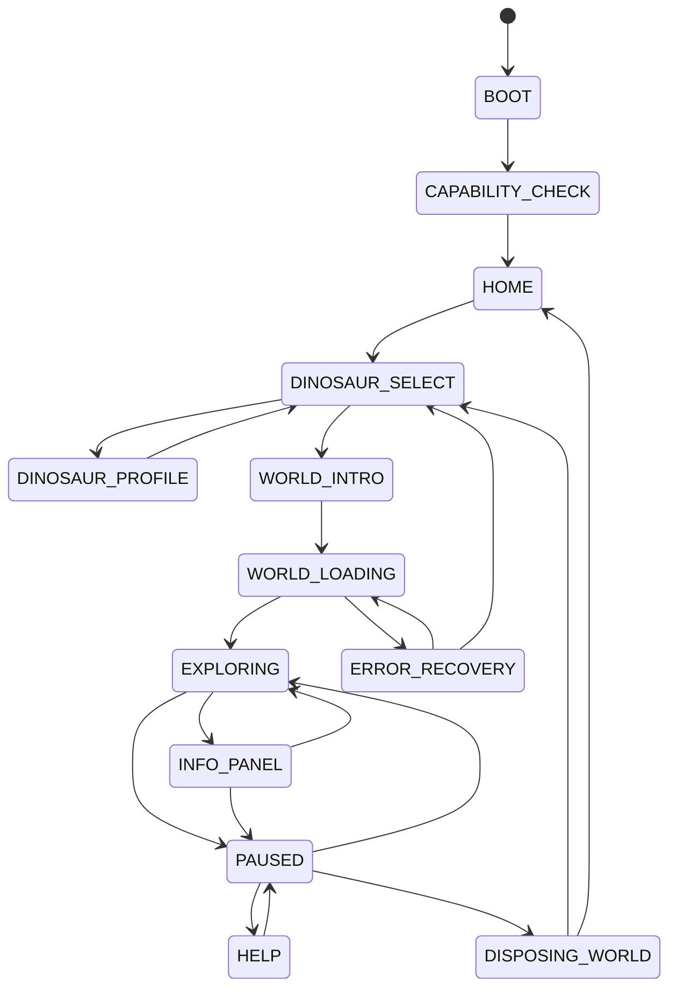

# HUELLAS VR — Etapa 4: Arquitectura técnica Babylon.js + WebGL2

**Versión:** 1.0  
**Fecha:** 25 de noviembre de 2026  
**Estado:** Etapa cerrada — arquitectura técnica y contratos de módulos especificados; lista para implementación  
**Motor 3D:** Babylon.js  
**API gráfica objetivo:** WebGL2  
**Plataformas:** Android, PC y visores VR compatibles  
**Integración:** módulo web autónomo para Atrapacuentos  
**Documentos base:** Etapas 1, 2 y 3

---

## 1. Propósito, alcance y límites

Este documento define la arquitectura que permitirá construir HUELLAS VR como una experiencia web 3D mantenible, modular, optimizada y verificable. Establece cómo se relacionan el motor, los mundos, los dinosaurios GLB, la interfaz, las entradas, el audio, los recursos y la capa de compatibilidad VR.

La arquitectura debe satisfacer estas condiciones:

- Babylon.js como motor 3D y WebGL2 como backend gráfico objetivo.
- Android y PC como plataformas de primera clase.
- VR como capacidad opcional detectada en tiempo de ejecución, no como requisito para abrir el módulo.
- Recursos propios/locales en la entrega de producción; no depender de CDN para ejecutar la experiencia.
- Cargar solo el mundo seleccionado y liberar recursos al abandonarlo.
- Mantener separadas la interfaz, la lógica de aplicación y la escena 3D.
- Integrarse en Atrapacuentos sin contaminar ni depender de sus estilos o estado global.
- Preservar la precisión paleontológica de la Etapa 1 y las identidades ambientales de la Etapa 2.
- Proporcionar diagnóstico, pruebas y recuperación ante fallos.

**Fuera del alcance de esta etapa:** construir los cinco escenarios, modelar o corregir los GLB, crear animaciones, implementar pantallas reales, programar controles finales, publicar el módulo o afirmar compatibilidad en dispositivos que todavía no se hayan probado. Esas tareas se ejecutarán en las etapas posteriores.

## 2. Decisiones arquitectónicas

| Área | Decisión | Motivo |
|---|---|---|
| Motor 3D | Babylon.js | Motor elegido para escena, materiales, cámara, carga y ciclo de render |
| Render | WebGL2 | Base gráfica acordada y amplia ruta de compatibilidad web |
| Lenguaje | TypeScript | Tipado de contratos, estados y recursos; reduce errores entre módulos |
| Aplicación | SPA ligera, sin framework UI obligatorio | Mantiene el módulo pequeño y desacoplado |
| Herramienta de desarrollo | Vite | Desarrollo local, resolución de módulos y compilación estática |
| Dependencias | Versiones fijadas y lockfile | Builds reproducibles; sin CDN en producción |
| Modelos | GLB/ glTF 2.0 | Formato de intercambio 3D para dinosaurios y recursos |
| Interfaz | HTML/CSS accesible, encapsulado | Mejor semántica y accesibilidad que dibujar todos los controles dentro del canvas |
| VR | Adaptador WebXR opcional + fallback | La aplicación funciona aunque VR no esté disponible |
| Estado | Máquina de estados explícita | Evita pantallas incoherentes, dobles cargas y transiciones inválidas |
| Recursos | Catálogo/manifiesto por mundo | Permite carga selectiva, validación y liberación |
| Pruebas | Unitarias, integración, navegador y dispositivos | No basta con que compile: se debe probar el ciclo completo |

### 2.1 Política de versiones

La versión concreta de Babylon.js, loaders, Vite, TypeScript y herramientas se fijará en el manifiesto de dependencias y en el lockfile al iniciar la implementación. No se debe actualizar una dependencia principal automáticamente durante una etapa de construcción o estabilización.

Antes de fijar el conjunto definitivo se debe comprobar:
- compatibilidad de Babylon.js con WebGL2 en los navegadores objetivo;
- carga de GLB/glTF y extensiones realmente utilizadas por los modelos;
- compatibilidad del adaptador WebXR con el navegador/visor de prueba;
- ausencia de dependencias que requieran CDN en producción;
- tamaño del bundle y compatibilidad de la cadena de compilación.

No se declara aquí un número de versión no verificado como si ya hubiera sido probado en Android y visores.

## 3. Arquitectura lógica por capas

La aplicación se divide en seis capas con dependencias en una sola dirección:

1. **Presentación:** pantallas HTML/CSS, HUD, paneles y accesibilidad.
2. **Aplicación:** navegación, casos de uso y máquina de estados.
3. **Dominio:** dinosaurios, mundos, puntos de interés y reglas educativas.
4. **Experiencia 3D:** Babylon Engine, escenas, cámaras, luces, materiales y entidades.
5. **Infraestructura:** carga de recursos, almacenamiento local, audio, telemetría local y capacidades.
6. **Adaptadores de plataforma:** táctil, teclado/ratón, orientación, WebXR y visor móvil compatible.

La capa de presentación no manipula directamente meshes ni carga archivos. La escena 3D no decide qué pantalla de menú mostrar. Los adaptadores de entrada emiten acciones normalizadas; no ejecutan lógica de juego por su cuenta.

### 3.1 Diagrama general



### 3.2 Reglas de dependencia

- La UI solo conoce servicios/casos de uso públicos.
- El dominio no importa Babylon.js ni APIs del navegador.
- Los gestores 3D reciben datos de dominio y manifiestos de recursos.
- Los adaptadores traducen eventos físicos a acciones internas.
- Ningún mundo importa directamente el código interno de otro mundo.
- El módulo anfitrión no accede a objetos internos; la integración usa una API pública pequeña.
- La infraestructura puede cambiar sin reescribir las reglas paleontológicas o la navegación.

## 4. Estructura de proyecto propuesta

Estructura fuente:

```text
huellasvr/
├── index.html
├── package.json
├── package-lock.json
├── tsconfig.json
├── vite.config.ts
├── public/
│   ├── assets/
│   │   ├── dinosaurs/
│   │   │   ├── atacamatitan/
│   │   │   ├── arackar/
│   │   │   ├── chilesaurus/
│   │   │   ├── gonkoken/
│   │   │   └── stegouros/
│   │   ├── worlds/
│   │   │   ├── tolar/
│   │   │   ├── hornitos/
│   │   │   ├── toqui/
│   │   │   ├── dorotea-superior/
│   │   │   └── dorotea-inferior/
│   │   ├── audio/
│   │   ├── ui/
│   │   └── manifests/
│   └── favicon.svg
├── src/
│   ├── main.ts
│   ├── app/
│   │   ├── Application.ts
│   │   ├── AppStateMachine.ts
│   │   ├── NavigationController.ts
│   │   ├── UseCases/
│   │   └── events/
│   ├── domain/
│   │   ├── dinosaurs/
│   │   ├── worlds/
│   │   ├── points-of-interest/
│   │   └── science/
│   ├── presentation/
│   │   ├── screens/
│   │   ├── components/
│   │   ├── hud/
│   │   ├── styles/
│   │   └── accessibility/
│   ├── engine/
│   │   ├── EngineHost.ts
│   │   ├── SceneManager.ts
│   │   ├── CameraManager.ts
│   │   ├── LightingManager.ts
│   │   ├── RenderQualityManager.ts
│   │   └── diagnostics/
│   ├── worlds/
│   │   ├── WorldFactory.ts
│   │   ├── WorldLifecycle.ts
│   │   ├── common/
│   │   ├── atacamatitan/
│   │   ├── arackar/
│   │   ├── chilesaurus/
│   │   ├── gonkoken/
│   │   └── stegouros/
│   ├── dinosaurs/
│   │   ├── DinosaurFactory.ts
│   │   ├── ModelLoader.ts
│   │   ├── AnimationController.ts
│   │   └── validation/
│   ├── assets/
│   │   ├── AssetCatalog.ts
│   │   ├── AssetLoader.ts
│   │   ├── AssetCache.ts
│   │   └── ResourceDisposer.ts
│   ├── input/
│   │   ├── InputManager.ts
│   │   ├── TouchAdapter.ts
│   │   ├── KeyboardMouseAdapter.ts
│   │   ├── DeviceOrientationAdapter.ts
│   │   ├── GazeAdapter.ts
│   │   └── WebXRAdapter.ts
│   ├── platform/
│   │   ├── CapabilityDetector.ts
│   │   ├── BrowserProfile.ts
│   │   └── FeaturePolicy.ts
│   ├── audio/
│   ├── storage/
│   ├── integration/
│   │   └── HostBridge.ts
│   ├── shared/
│   │   ├── types/
│   │   ├── constants/
│   │   ├── errors/
│   │   └── utils/
│   └── tests/
│       ├── unit/
│       ├── integration/
│       └── fixtures/
└── docs/
```

La estructura es una guía de organización, no una orden de crear carpetas vacías. Cada módulo se añade junto con su implementación y pruebas. Los recursos grandes se mantienen como archivos binarios locales versionados o mediante un sistema de almacenamiento de artefactos aprobado; no se incrustan como cadenas Base64 en TypeScript.

### 4.1 Salida de producción

La compilación produce una carpeta estática desplegable bajo una ruta propia, por ejemplo `/huellas-vr/`. El HTML y los bundles JS/CSS se generan localmente; los GLB, texturas y audios se distribuyen como recursos locales con rutas relativas al módulo.

No se exige que toda la experiencia esté en un único HTML: los modelos 3D y texturas deben conservarse como recursos binarios independientes para permitir carga selectiva, caché y liberación de memoria. La entrega de producción no debe depender de scripts remotos ni CDNs.

## 5. Contratos de dominio

### 5.1 Identidad de dinosaurio

Cada especie tiene un identificador estable y no traducible para uso interno:

- `atacamatitan`
- `arackar`
- `chilesaurus`
- `gonkoken`
- `stegouros`

Los nombres científicos, etiquetas, descripciones, ubicación, edad y advertencias se mantienen en datos declarativos. No se duplican como textos sueltos en componentes UI o scripts de cada mundo.

### 5.2 Identidad de mundo

| ID | Mundo | Especie |
|---|---|---|
| `tolar` | Tolar | Atacamatitan chilensis |
| `hornitos` | Hornitos | Arackar licanantay |
| `toqui` | Toqui | Chilesaurus diegosuarezi |
| `dorotea-superior` | Dorotea superior | Gonkoken nanoi |
| `dorotea-inferior` | Dorotea inferior | Stegouros elengassen |

Un mundo no debe cargar accidentalmente la especie o ficha de otro mundo.

### 5.3 Tipos conceptuales

```ts
type DinosaurId =
  | "atacamatitan"
  | "arackar"
  | "chilesaurus"
  | "gonkoken"
  | "stegouros";

type WorldId =
  | "tolar"
  | "hornitos"
  | "toqui"
  | "dorotea-superior"
  | "dorotea-inferior";

type EvidenceKind =
  | "direct-evidence"
  | "scientific-interpretation"
  | "artistic-reconstruction";

interface DinosaurDefinition {
  id: DinosaurId;
  scientificName: string;
  worldId: WorldId;
  modelAssetId: string;
  profileContentId: string;
}

interface WorldDefinition {
  id: WorldId;
  dinosaurId: DinosaurId;
  manifestPath: string;
  sceneFactoryKey: string;
}

interface PointOfInterestDefinition {
  id: string;
  titleKey: string;
  descriptionKey: string;
  evidenceKind: EvidenceKind;
  worldId: WorldId;
  anchorId: string;
}
```

Estos contratos son referencia de diseño; se convertirán en tipos reales y validadores durante la implementación.

## 6. Máquina de estados de la aplicación

La aplicación usa estados explícitos y transiciones autorizadas. No se debe controlar la navegación mediante una colección de booleanos independientes que permitan, por ejemplo, mostrar pausa y carga al mismo tiempo.

Estados mínimos:

- `BOOT`: inicialización de la aplicación.
- `CAPABILITY_CHECK`: detección de capacidades.
- `HOME`: pantalla de inicio.
- `DINOSAUR_SELECT`: selección de especie.
- `DINOSAUR_PROFILE`: ficha/Bitácora.
- `WORLD_INTRO`: presentación del mundo.
- `WORLD_LOADING`: carga del mundo seleccionado.
- `EXPLORING`: exploración activa.
- `INFO_PANEL`: panel de punto de interés abierto.
- `PAUSED`: pausa.
- `HELP`: ayuda y controles.
- `ERROR_RECOVERY`: error recuperable.
- `DISPOSING_WORLD`: liberación de mundo antes de cambiar/salir.

### 6.1 Transiciones esenciales



Reglas:
- Cada carga tiene un identificador de operación; una respuesta tardía de una carga cancelada no puede reemplazar el mundo actual.
- Solo se entra en `EXPLORING` cuando escena, cámara, recursos esenciales y entidad principal están listos.
- Pausa bloquea acciones de exploración y controla el render según la política de plataforma; no destruye la escena.
- Cerrar un panel restaura el estado anterior válido.
- Al cambiar de mundo se ejecuta limpieza antes de cargar el siguiente.
- Los errores no deben dejar la aplicación sin una ruta de recuperación.

## 7. Ciclo de vida del motor y escenas

### 7.1 Inicialización

1. Verificar existencia del elemento canvas y contexto WebGL2.
2. Crear Engine Babylon.js con configuración compatible con el dispositivo.
3. Registrar observadores de resize, visibilidad y pérdida/restauración de contexto.
4. Crear gestores de escena, cámara, luces, recursos y diagnóstico.
5. Iniciar la máquina de estados.
6. No construir escenarios ni descargar GLB de mundos antes de que el usuario seleccione uno.

Si WebGL2 no está disponible, mostrar una pantalla informativa de incompatibilidad y una salida limpia. No continuar con una escena parcialmente inicializada.

### 7.2 Un motor, una escena activa de mundo

La arquitectura usa un host de motor controlado por la aplicación y una escena activa de exploración. La UI HTML permanece fuera del canvas. Los menús previos a la exploración no necesitan crear cinco escenas 3D completas.

Puede existir una escena ligera de transición o presentación, pero no se mantienen cinco mundos completos residentes simultáneamente en memoria.

### 7.3 Bucle de render

- Un único bucle de render controlado por EngineHost.
- Actualizaciones de simulación separadas de la presentación cuando sea necesario.
- Delta temporal limitado para evitar saltos grandes tras suspensiones.
- Pausa/resume al cambiar visibilidad o entrar/salir de XR según la plataforma.
- No crear nuevos observadores ni bucles en cada cambio de mundo.
- Retirar listeners y observables al destruir sus propietarios.

## 8. Arquitectura de los cinco mundos

Cada mundo implementa un contrato común y declara sus particularidades mediante configuración y módulos propios.

Contrato conceptual:

```ts
interface WorldModule {
  readonly id: WorldId;
  load(context: WorldLoadContext): Promise<WorldRuntime>;
  activate(runtime: WorldRuntime): void;
  pause(runtime: WorldRuntime): void;
  resume(runtime: WorldRuntime): void;
  dispose(runtime: WorldRuntime): Promise<void>;
}
```

Responsabilidades comunes:
- Crear terreno, horizonte, cielo y elementos ambientales del mundo.
- Instanciar los puntos de interés definidos en su manifiesto.
- Registrar colisiones/interacciones necesarias.
- Exponer anchors identificables para dinosaurio y elementos informativos.
- Informar qué recursos son esenciales y cuáles opcionales.
- Liberar meshes, materiales, texturas, sonidos, observadores y cachés de escena propios.

Responsabilidades prohibidas:
- Alterar navegación global.
- Cargar recursos de otro mundo sin declararlo.
- duplicar el controlador global de cámara.
- crear su propio bucle de render.
- modificar estilos globales del sitio anfitrión.

### 8.1 Adaptación científica

La arquitectura permite asociar a cada objeto o punto de interés metadatos de certeza. La UI informativa consume esa etiqueta y muestra si el contenido es evidencia directa, interpretación científica o reconstrucción artística.

Las advertencias específicas de las etapas 1 y 2 deben almacenarse en los datos de contenido, no quedar solo como comentarios de desarrollo.

### 8.2 Reutilización sin homogeneizar

Se comparten utilidades, sistemas de carga, iluminación configurable, interacción y componentes ambientales genéricos. No se fuerza a los cinco mundos a compartir la misma geometría, composición o paleta. Cada módulo conserva identidad y restricciones descritas en Etapa 2.

## 9. Arquitectura de dinosaurios y modelos GLB

### 9.1 Pipeline de incorporación

Cada dinosaurio tendrá un directorio propio con:
- archivo GLB aprobado;
- manifiesto de modelo;
- lista de animaciones detectadas y sus nombres reales;
- metadatos de escala/unidades y orientación;
- materiales/texturas asociados;
- licencia y procedencia del recurso;
- resultado de validación técnica.

No se asumirá que todos los GLB tienen el mismo esqueleto, nombres de huesos, escala, orientación, animaciones o materiales.

### 9.2 Validación antes de integrar

Comprobaciones requeridas:
1. El archivo es un GLB válido y se puede parsear.
2. Las texturas y dependencias están incluidas o correctamente referenciadas.
3. El modelo aparece con orientación y escala coherentes.
4. El origen/pivote y suelo de apoyo están documentados.
5. Se inspeccionan mallas, materiales y número de primitivas.
6. Se detectan extensiones glTF requeridas y se confirma soporte.
7. Se identifican clips de animación reales; no se inventan nombres.
8. Se comprueba que el modelo no tiene errores de transparencia, normales o materiales.
9. Se registra memoria/tamaño de descarga y coste aproximado de render.
10. Se confirma que la licencia permite el uso previsto.

### 9.3 Carga y animación

- Carga asíncrona y cancelable.
- Mostrar estado de preparación sin bloquear toda la interfaz.
- Crear un contenedor/raíz transformable por dinosaurio.
- Normalizar orientación y escala mediante configuración específica validada, no por heurísticas destructivas.
- Usar AnimationGroup/animaciones disponibles después de inspeccionar el archivo.
- Controlar reproducción, pausa y mezcla desde AnimationController.
- No reproducir animaciones inexistentes ni asumir que un clip llamado "idle" está presente.
- Evitar duplicar el modelo para cada interacción.
- Liberar recursos del modelo al abandonar el mundo si no hay una política explícita de caché con presupuesto.

## 10. Catálogo, carga y ciclo de vida de recursos

### 10.1 Manifiestos por mundo

Cada manifiesto lista:
- identificador y versión de esquema;
- recursos esenciales;
- recursos opcionales;
- ruta relativa local;
- tipo y tamaño esperado cuando se conozca;
- hash/checksum para integridad cuando se implemente;
- dependencias;
- presupuesto de carga;
- política de caché.

El catálogo permite validar antes de iniciar una carga que todas las rutas requeridas existen en el paquete de producción.

### 10.2 Secuencia de carga

1. Resolver el manifiesto del mundo seleccionado.
2. Validar esquema y rutas.
3. Cargar recursos esenciales con prioridad.
4. Crear geometría y materiales principales.
5. Cargar dinosaurio y recursos necesarios para la entrada.
6. Mostrar el mundo cuando los elementos críticos estén listos.
7. Cargar elementos secundarios de forma progresiva.
8. Marcar carga completa cuando los recursos previstos hayan terminado.

Los porcentajes solo se muestran cuando el total de trabajo es medible. Si no se puede calcular, la UI usa fases descriptivas.

### 10.3 Caché y memoria

- Caché limitada y explícita; no retener todos los mundos.
- Compartir materiales/texturas solo cuando realmente tengan la misma propiedad y ciclo de vida.
- Contabilizar recursos compartidos para no destruirlos mientras otro propietario los use.
- Destruir recursos únicos al hacer dispose.
- No llamar indiscriminadamente a dispose sobre recursos compartidos.
- Liberar observables, listeners, audio y referencias a escenas.
- Revisar memoria de GPU/CPU en ciclos repetidos de entrada/salida.

### 10.4 Fallos y cancelación

Un fallo de recurso opcional puede degradar de forma controlada el detalle visual. Un fallo de recurso esencial debe detener la transición y ofrecer reintento o retorno. No sustituir silenciosamente un dinosaurio por otro ni presentar un mundo incorrecto.

## 11. Entrada y controles normalizados

Los adaptadores convierten eventos de plataforma en acciones internas comunes.

Acciones de dominio de entrada:
- `CONFIRM`
- `CANCEL`
- `PAUSE`
- `MOVE`
- `LOOK`
- `SELECT_TARGET`
- `RECENTER`
- `OPEN_HELP`

Adaptadores:
- TouchAdapter: toque, arrastre y gestos compatibles.
- KeyboardMouseAdapter: teclado, ratón y foco.
- DeviceOrientationAdapter: orientación solo tras detección y permiso aplicable.
- GazeAdapter: foco por mirada y confirmación por permanencia cuando esté habilitado.
- WebXRAdapter: eventos de sesión y controladores disponibles.

Los adaptadores no deben competir por el mismo evento. InputManager selecciona el esquema activo y permite fallback. Los cambios de modo se comunican a la UI para que Ayuda muestre instrucciones correctas.

### 11.1 Control táctil

- Gestos explícitos y documentados.
- Evitar gestos de navegador interceptados sin necesidad.
- No usar áreas de toque pequeñas.
- Separar interacción con HUD de interacción con escena.
- Permitir volver a controles alternativos si el sensor falla.

### 11.2 Mirada y visor móvil

La selección por mirada requiere foco estable, indicador de progreso y umbral de permanencia configurable. Debe existir cancelación y protección contra activaciones accidentales. No se asume que todos los visores móviles exponen un botón físico ni que todos los navegadores ofrecen la misma API.

Si el dispositivo no ofrece WebXR, una experiencia estereoscópica de visor móvil solo podrá ofrecerse mediante un modo alternativo específicamente implementado y probado; no se debe confundir ese modo con WebXR ni anunciarlo como compatible antes de validarlo.

## 12. WebXR y compatibilidad VR

### 12.1 Estrategia

WebXR es un adaptador opcional, no el núcleo de la aplicación. Al inicio se detecta:
- contexto seguro HTTPS;
- existencia de navigator.xr;
- soporte de sesión inmersiva VR;
- features requeridas/opcionales disponibles;
- controladores y perfiles cuando el navegador los informe.

La detección de API no equivale a validación de hardware. La matriz real de visores y navegadores debe completarse en Etapa 7.

### 12.2 Entrada y salida

- El usuario solicita entrar a VR mediante acción explícita.
- Si la sesión no se puede iniciar, se explica y se conserva el modo 3D normal.
- La sesión tiene ciclo de vida controlado: iniciar, presentar, finalizar, recuperar cámara y controles.
- Al salir, la aplicación vuelve a un estado coherente y no deja el render suspendido.
- La pérdida de foco o finalización de sesión no destruye automáticamente los datos de selección.

### 12.3 Comodidad

- Sin giros de cámara forzados.
- Sin aceleraciones o teletransportes automáticos.
- Horizonte y referencias espaciales estables.
- Paneles legibles y ubicados en zona cómoda.
- Recentrado bajo petición explícita.
- Evitar efectos de pantalla que provoquen malestar.
- No depender de vibración háptica.

## 13. Renderizado y calidad adaptable

### 13.1 Presupuesto por dispositivo

La calidad se gestiona mediante perfiles configurables, no mediante un conjunto fijo de efectos máximos para todos los equipos.

Perfiles iniciales:
- **Móvil equilibrado:** prioriza estabilidad térmica, memoria y respuesta.
- **PC equilibrado:** aprovecha mayor capacidad sin asumir GPU dedicada.
- **VR compatible:** prioriza frame pacing y comodidad; reduce efectos costosos si afectan la estabilidad.

Estos perfiles son objetivos de configuración, no garantías de FPS. Los valores se calibrarán en Etapa 8 con dispositivos reales.

### 13.2 Escalado de resolución

- Separar resolución de render de tamaño CSS del canvas.
- Limitar el factor de resolución mediante configuración y medición.
- En VR, respetar la configuración de framebuffer recomendada por runtime.
- No forzar una resolución interna alta en móviles de gama baja.
- Ajustar calidad gradualmente y registrar cambios para diagnóstico.

### 13.3 Optimización prevista

- Instancing/thin instances para elementos repetidos compatibles.
- Geometrías y materiales compartidos donde proceda.
- Frustum culling y distancia de visibilidad.
- LOD para objetos apropiados.
- Colisiones simples, no mallas complejas para todo.
- Sombras limitadas a elementos relevantes y distancias controladas.
- Partículas con presupuestos por mundo y distancia.
- Texturas comprimidas solo tras validar soporte y pipeline.
- Evitar reconstrucciones de geometría/material cada frame.
- Limitar observables y asignaciones dentro del bucle de actualización.

No se reduce la calidad artística arbitrariamente; se asignan presupuestos y técnicas por tipo de recurso y capacidad medida.

## 14. Integración de UI y escena

La UI HTML/CSS vive en una capa propia sobre o junto al canvas. Los paneles no deben dibujarse como texto 3D salvo elementos diegéticos que el diseño requiera expresamente.

Contrato de comunicación:
- UI emite comandos de aplicación.
- Aplicación consulta estado y publica eventos.
- Escena publica selección de puntos de interés y eventos de carga.
- UI representa estados, errores y paneles.
- Ningún componente modifica directamente el estado interno de Babylon.

Ejemplos de comandos:
- `selectDinosaur(id)`
- `openDinosaurProfile(id)`
- `enterWorld(worldId)`
- `pauseExploration()`
- `resumeExploration()`
- `selectPointOfInterest(pointId)`
- `exitToHome()`

Los nombres son contratos conceptuales; se consolidarán como API tipada durante implementación.

## 15. Integración con Atrapacuentos

### 15.1 Aislamiento

- Desplegar en una ruta propia, por ejemplo `/huellas-vr/`.
- Todos los recursos se resuelven desde la base del módulo.
- CSS encapsulado bajo un contenedor raíz con prefijo propio.
- No modificar estilos, DOM, navegación ni variables globales del sitio anfitrión.
- No asumir que Atrapacuentos carga Babylon.js u otra dependencia.
- No crear globals salvo una API de integración documentada y estrictamente necesaria.

### 15.2 API pública del módulo

El anfitrión puede:
- iniciar el módulo;
- solicitar cierre cuando el estado lo permita;
- recibir eventos públicos no sensibles como carga completada o error recuperable.

El anfitrión no puede:
- manipular meshes;
- cambiar especies internamente;
- acceder a datos de dispositivo innecesarios;
- alterar estado de escena.

Si se usa iframe, la comunicación se hará mediante postMessage con origen permitido y esquema validado. Si se monta directamente, se usará un contenedor raíz y una función de montaje/desmontaje. La decisión final entre iframe y montaje directo se valida con la arquitectura real del sitio durante integración; ambos caminos deben mantener aislamiento.

### 15.3 Seguridad

- HTTPS en producción.
- Validación estricta del origen de mensajes.
- No insertar HTML no confiable.
- No ejecutar scripts remotos ni cargar recursos arbitrarios desde contenido.
- Política de permisos mínima para cámara, micrófono, sensores y VR.
- No solicitar información personal para jugar.
- Evitar almacenamiento de datos infantiles o telemetría remota por defecto.

## 16. Persistencia local

Solo preferencias no sensibles:
- volumen;
- última especie seleccionada (opcional);
- esquema de control elegido;
- preferencia de movimiento reducido si corresponde.

La experiencia debe funcionar si localStorage está bloqueado, borrado o no disponible. No guardar fotografías, datos identificables, ubicación ni información de cuenta en esta etapa.

## 17. Errores, observabilidad y diagnóstico

### 17.1 Categorías de error

- Inicialización de motor.
- WebGL2/contexto perdido.
- Manifiesto inválido o ruta ausente.
- GLB inválido o extensión no soportada.
- Textura/audio fallido.
- Error de construcción de mundo.
- Error de entrada o permiso.
- Fallo de sesión WebXR.
- Error de integración con anfitrión.

Cada error tendrá código interno, contexto, severidad, acción de recuperación y mensaje amigable. No se mostrarán trazas internas al niño.

### 17.2 Diagnóstico de desarrollo

Panel local opcional:
- navegador y capacidades detectadas;
- renderer/backend;
- mundo activo y estado de aplicación;
- tiempo de carga por fase;
- FPS/frame time;
- cantidad de meshes/materiales/texturas cuando esté disponible;
- errores de recursos;
- memoria estimada cuando el navegador la exponga.

El diagnóstico no debe requerir conexión a servidor ni transmitir datos. Las métricas no soportadas se marcan como no disponibles, nunca como cero.

## 18. Estrategia de pruebas de arquitectura

### 18.1 Pruebas unitarias

- transiciones permitidas/prohibidas de máquina de estados;
- relación única especie-mundo;
- validación de manifiestos;
- normalización de acciones de entrada;
- clasificación de evidencia;
- políticas de caché y liberación;
- preferencias con almacenamiento no disponible.

### 18.2 Pruebas de integración

- iniciar y desmontar EngineHost repetidamente;
- cargar y liberar cada mundo;
- cancelar carga y evitar que resultados tardíos se apliquen;
- cargar GLB real y reproducir solo clips existentes;
- abrir/cerrar ficha, panel de interés y pausa;
- cambiar entre mundos sin duplicar loops/listeners;
- simular pérdida y restauración de contexto cuando sea viable;
- simular fallo de recurso esencial y opcional.

### 18.3 Pruebas de navegador/dispositivo

Matriz mínima posterior:
- Android Chrome con WebGL2.
- Android navegador compatible alternativo.
- PC Chrome/Edge/Firefox con WebGL2.
- PC sin GPU dedicada o con GPU integrada.
- Un visor WebXR compatible real.
- Un visor móvil económico y su navegador real, si se quiere ofrecer ese modo.

No se marca una combinación como compatible hasta probar inicio, selección, carga, exploración, pausa, salida y recuperación.

## 19. Riesgos y decisiones pendientes de validación

| Riesgo | Mitigación |
|---|---|
| Diferencias de WebXR entre visores/navegadores | Detección dinámica y matriz real de pruebas en Etapa 7 |
| GLB demasiado pesados | Auditoría de modelos y presupuesto de recursos en Etapa 6/8 |
| Memoria GPU limitada en Android | Carga de un solo mundo, dispose y medición |
| Pérdida de contexto WebGL | Manejadores de pérdida/restauración y recuperación |
| CSS/JS del sitio anfitrión interfieren | Aislamiento, prefijo y prueba de integración |
| Modelos con rigs/animaciones diferentes | Inspección individual de cada GLB |
| Modo visor móvil sin API universal | Tratarlo como adaptador separado y no prometerlo sin prueba |
| Bundle o recursos remotos accidentales | Build offline y auditoría de red en Etapa 9 |

Decisiones que deben cerrarse con evidencia durante las siguientes etapas:
- versiones exactas de dependencias;
- navegador y visor concretos certificados;
- dimensiones/LOD y compresión definitivos de cada GLB;
- valores de calidad por dispositivo;
- modalidad de montaje final en Atrapacuentos (iframe o montaje directo);
- compatibilidad exacta de modo estereoscópico para visores móviles sin WebXR.

No son vacíos de arquitectura: son parámetros dependientes de archivos reales, navegador, dispositivos o pruebas de integración que aún no se han ejecutado.

## 20. Criterios de aceptación de la Etapa 4

- [x] Babylon.js y WebGL2 definidos como base.
- [x] TypeScript, compilación y dependencias locales especificados.
- [x] Capas y reglas de dependencia documentadas.
- [x] Estructura de proyecto definida.
- [x] Contratos de especies, mundos y puntos de interés establecidos.
- [x] Máquina de estados y transiciones principales definidas.
- [x] Ciclo de vida del motor y escenas definido.
- [x] Contrato común para los cinco mundos definido.
- [x] Pipeline de inspección, carga y animación de GLB definido.
- [x] Catálogo, carga progresiva, caché y liberación de recursos definidos.
- [x] Adaptadores de entrada y normalización de acciones definidos.
- [x] Estrategia WebXR y fallback descrita sin prometer compatibilidad no probada.
- [x] Renderizado adaptable y líneas de optimización documentados.
- [x] Integración aislada con Atrapacuentos especificada.
- [x] Privacidad, errores, diagnóstico y pruebas definidos.
- [x] Riesgos y decisiones dependientes de pruebas identificados.

### Límite de validación

Este cierre confirma la arquitectura documental y los contratos de diseño. **No significa que el repositorio ya contenga la aplicación implementada, que Babylon.js esté instalado, que los GLB hayan sido inspeccionados, ni que WebXR o los dispositivos hayan sido probados.** Esas comprobaciones corresponden a la implementación y etapas de validación posteriores.

## 21. Entrada para la Etapa 5

La Etapa 5 construirá los cinco mundos 3D respetando:
- los documentos paleontológico y ambiental de las etapas 1 y 2;
- el contrato WorldModule y el ciclo de vida de esta arquitectura;
- carga selectiva y liberación de recursos;
- identidad visual independiente por mundo;
- puntos de interés con clasificación de evidencia;
- compatibilidad con el sistema común de cámara, entrada e interfaz.

La construcción de mundos no debe introducir dependencias remotas, bucles de render paralelos, estados globales duplicados ni recursos compartidos sin propietario definido.

## 22. Acta de cierre

**Etapa 4 cerrada en alcance de arquitectura y documentación.** Quedan definidos el stack, la separación por capas, la estructura fuente, los contratos de dominio, la máquina de estados, el ciclo de vida de escenas, la gestión de GLB y recursos, los adaptadores de entrada, la estrategia VR, la integración con Atrapacuentos y la estrategia de pruebas.

La implementación funcional comienza en las etapas siguientes. No se declara construida ni probada ninguna pantalla, mundo, modelo o sesión VR por el solo hecho de estar especificada aquí.
